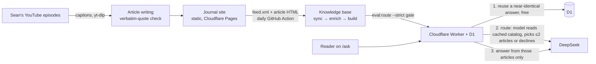

# iherng Journal + AIherng

**Live:** [iherng-journal.pages.dev](https://iherng-journal.pages.dev) · **Chatbot:** [/ask](https://iherng-journal.pages.dev/ask)

An editorial companion to Sean Tan's (@iherng) Malaysian property YouTube channel,
with a grounded chatbot on top. **AIherng** answers a buyer's property question in
Sean's voice, using only articles written from his episodes' captions. Each answer
cites its sources and links to the original video, and costs about $0.0009.



### Eval results (2026-10-13, 116 articles in the knowledge base)

| Eval | Result | Cost |
| --- | --- | --- |
| Router: right article, or a correct decline | **56/56**: 48/48 in scope (English, Chinese, Malay), 8/8 traps refused, 0 wrongly refused | $0.00027 per question |
| Answers: automatic rule checks | **14/15** | about $0.0009 per new question, routing included |

- **Router prompt cache:** 99% of its input tokens hit DeepSeek's cache, because the catalog it reads is byte-identical between calls.
- **Traps:** stock tips, a car loan, the current OPR, a Python script, prompt injection, and named projects the Journal hasn't reviewed.
- **Answer checks:** the answer must be in Chinese and in Sean's first person. Only his verbatim line may appear in quotes, every paragraph must cite its source, and the answer must not mention the episode's viewer.
- **The one answer miss:** the answer compared the asker to the episode's viewer.

Design notes, trade-offs (catalog routing rather than vectors or BM25, answer reuse, cost controls) and the eval history are in [`ask-sean/DESIGN.md`](ask-sean/DESIGN.md), with an English summary at the top. Commands are in [`ask-sean/README.md`](ask-sean/README.md).

### Repository layout

| Path | What it is |
| --- | --- |
| `app/`, `components/`, `lib/`, `content/` | The Journal: Next.js API on Vite (vinext), static export, 189 articles as JSON |
| `ask-sean/` | AIherng: Cloudflare Worker, knowledge-base pipeline, evals, and the job that turns new episodes into articles |
| `.github/workflows/update-knowledge.yml` | Daily: sync the knowledge base from the live site, run the router eval, and deploy the Worker only if it passes |
| `.claude/skills/iherng-article/` | The article-writing workflow: fetch captions, write, verify quotes, register |
| `scripts/` | Build-time checks (`check-content.mjs`, `verify_quotes.py`), SEO and social-card generators, and caption cleaning |

## The Journal

The site has fifty-three property-review articles, sixty-six Asking Sean podcast articles and seventy buyer guides.

## Run locally

```sh
npm install
npm run dev
```

## Architecture

- React + Vinext App Router, using the Sites starter.
- Static export configured in `next.config.ts`; public build output is `dist/client`.
- Home: `/`; series: `/property-reviews`, `/iherng-podcast`, and `/buyer-guides`; tools: `/calculator` and `/rental-calculator`.
- Each article has a permanent `/articles/[slug]` route.
- Article content lives in individual JSON files in `content/articles`.
- `lib/articles.ts` registers articles; series definitions are in `content/series.json` and site-wide constants in `site.config.json`.
- Shared editorial components live in `components/journal.tsx`; styles in `app/globals.css`.
- `lib/seo.ts` builds the canonical URLs, Open Graph metadata and JSON-LD; `components/json-ld.tsx` renders it.
- `ask-sean/` holds the AIherng chatbot (formerly "Ask Sean") behind `/ask`: a Cloudflare Worker with its own
  `package.json`, knowledge base and README. It also runs the daily job that turns new
  Asking Sean videos into articles here. The site's typecheck and lint skip that folder.
- `.github/workflows/update-knowledge.yml` refreshes the chatbot from the live site.

## Article formats

Property reviews can also carry an optional `standout`, the one idea Sean was
most taken with, shown as "What caught Sean's eye" between the sections and the
3 on 3.

Property reviews are kept short: two sections, "What sets it apart" (what this
project has that others don't, with Sean's figures) and "Where it is" (the
location as Sean describes it), an optional "Rent and returns" when Sean
discusses rent, then "Sean's Take 3 on 3", the heart of the
review. Every review episode ends with Sean naming three things he likes and
three he doesn't; the 3 on 3 follows that list, in his order and with his
specifics, and the page labels it "What Sean likes" and "What Sean doesn't".

The iherng Podcast and Buyer Guides series use a problem-and-answer format
instead, because readers arrive with a specific question. Each of those
articles has a `qa` object in its JSON, rendered by
`components/ask-sean-summary.tsx` in this order:

1. **The question** (`kind: "question"`, when a viewer wrote in) or **the
   problem** (`kind: "problem"`, for a topic Sean raises himself): the
   situation in `context`, then the `question` itself.
2. **Sean's answer**: one short `quote` in his exact words, then the plain
   `answer`.
3. **Why**: three or four `reasons`, each carrying Sean's own figures.
4. **What to do**: three to five `actions`.
5. **When this doesn't apply**: the `caveat`.

When a guest on Sean's channel gives the answer (a lawyer he interviews, say),
`qa.answeredBy` names them: the page then reads "Lawyer Tea's answer" rather than
"Sean's answer", the editorial note says the advice is theirs, and the Ask Sean
chatbot attributes it to them too.

Only the quote is verbatim, and it stays under 15 words; everything else is
paraphrase. Run `python scripts/verify_quotes.py` after editing any article to
confirm each quote still appears word for word in its transcript.

These articles skip the large cover image so the question and answer sit near
the top of the page; the episode is still embedded further down.
`askSeanFor`, `keyPointsFor` and `bodyTextFor` in `lib/articles.ts` let search,
reading time, structured data and the RSS feed handle both formats.

## Calculators

`/calculator` estimates the upfront cash and monthly instalment on a Malaysian
purchase. It is entirely client-side, so it works under static export.

- `lib/calculator.ts` holds the model and, at the top, the statutory scales:
  MOT stamp duty (Stamp Act 1949 First Schedule Item 32(a)), the solicitors'
  remuneration scale (SRO 2023) applied separately to the SPA and the loan
  agreement, and the flat 0.5% loan agreement stamp duty.
- `RATES_REVIEWED` dates that review and is shown to the reader. Update it
  whenever a rate changes.
- Temporary first-home stamp duty exemptions from the annual Budget are
  deliberately not modelled, because they lapse and vary by year; `RATE_NOTES`
  says so on the page.
- The figures are presented as an estimate, not a quotation. Bank valuation,
  margin of finance and debt service ratio rules are out of scope.

Verify any change to the scales against the current source before shipping —
these numbers inform real purchase decisions.

`/rental-calculator` answers the landlord question: does the rent cover the
loan? `lib/rental.ts` takes price, loan margin, rate, tenure, expected rent,
maintenance, yearly costs and a vacancy allowance, and returns net monthly cash
flow, shown green when positive and red when negative, alongside break-even
rent and gross and net yield.

- Cash flow excludes one-off purchase costs, which `/calculator` covers.
- Income tax on rent is excluded, since it depends on the owner's band.
- Net yield is a property-level figure and so excludes financing, while cash
  flow includes the instalment. They answer different questions on purpose.
- The page states plainly that cash flow alone does not decide whether a
  purchase is sound.

Both calculators share the form controls in `components/calc-field.tsx` and the
`CalculatorTabs` strip that links them.

## Topic filters

Series pages filter by a fixed, short list so the filter doesn't grow with every
article: property reviews by `propertyType` (Landed or High-Rise) and by
`stage` (`show-unit` if Sean filmed a show unit while the project was being
built, `completed` if he saw the finished project; show-unit reviews also carry a
badge and a note saying so) and by `state` (from `content/states.json`; only
states with a review appear), podcast and
buyer guide articles by `category`, one of the six ids in
`content/categories.json` (Loans & finance, Buying process, Choosing a home,
Investing & risk, Family & life stage, Retirement & legacy). Each article's
finer `tag` still shows on its card and is searchable. `npm run check`
(`scripts/check-content.mjs`, also the first `prebuild` step) fails the build on
a missing or unknown value, so add a category only by editing that file on
purpose. The automated journal job reads the same file and must pick one.

Grids show 12 stories, then a "Show more stories" button adds 12 at a time.

## Sorting and view counts

Each series page can be sorted latest first, oldest first, most viewed or least
viewed (buyer guides also keep "Guide order", their default). "Views" are the
YouTube views of each article's video, shown on every card and stored in
`content/view-counts.json` with the date they were fetched, which the page
shows when sorting by views.

Refresh them before a deploy with `npm run views`, then commit the file. It is
not part of `prebuild`, so builds stay offline and never dirty the tree; a video
YouTube won't answer for keeps its previous count, and a new article without a
count sorts last until the next refresh.

## Search engine assets

`sitemap.xml`, `robots.txt` and `feed.xml` are generated into `public/` by
`scripts/generate-seo-assets.mjs`, which runs automatically as the `prebuild`
step. Regenerate them on their own with `npm run seo`. The three files are
gitignored because every build rewrites them.

They are **not** Next.js metadata routes (`app/sitemap.ts` and friends), because
neither form survives this project's static export: vinext's
`emitStaticMetadataFiles` copies only literal metadata files and skips
code-generated ones, and `output: 'export'` drops route handlers entirely. Both
were tried and produced no output. If the site ever moves off static export,
they can move back into `app/`.

Structured data emitted per page:

| Page | JSON-LD |
| --- | --- |
| Every page | `WebSite` |
| `/articles/[slug]` | `Article`, `VideoObject`, `BreadcrumbList` |
| Series pages | `CollectionPage` with `ItemList`, `BreadcrumbList` |
| `/calculator`, `/rental-calculator` | `WebApplication`, `BreadcrumbList` |

The `VideoObject` describes Sean's original episode, which the page embeds — he
is marked as its creator and uploader, and `contentUrl` points at YouTube. The
`Article` records the summary as derived work via `isBasedOn` and `citation`.

The default social card is `public/og-default.png`, rebuilt with
`python scripts/make_og_image.py` after any palette, wordmark or count change.
Article pages use the episode's own YouTube thumbnail instead.

## Add an article

1. Copy an existing JSON content file and give it a unique slug and verified video ID.
2. Add its import to `lib/articles.ts` and include it in `articles`. Give podcast and buyer guide articles a `category` from `content/categories.json`, and reviews a `propertyType` of Landed or High-Rise.
3. Write an original summary based on material actually reviewed, with accurate dates and source links. Podcast and buyer guide articles use the `qa` structure described under Article formats, written from the full transcript; never from the title or episode notes alone.
4. Collection counts are derived from the registered articles. Update any homepage or footer summary copy that refers to a fixed count.
5. Run `npx tsc --noEmit` and `npm run build`. The build regenerates the sitemap and feed; rerun `python scripts/make_og_image.py` if the counts on the social card changed.

## Editorial provenance

The original six video IDs, titles, publication timestamps, durations and thumbnail URLs were verified against YouTube on 8 September 2026. Captions were unavailable at the time, so the three original property reviews were first written from Sean's public episode descriptions.

On 6 October 2026 all twelve iherng Podcast and Buyer Guide articles were rewritten in the problem-and-answer format from Sean's full English captions. Six of them had previously been written without a transcript: the three podcast episodes, whose earlier caption fetch returned nothing, and three guides based only on their titles. Their captions were retrieved with yt-dlp and cleaned with `scripts/clean_youtube_vtt.py`. Older automatic captions (2017 to 2020) are unclear in places, so those articles include only clearly stated points. Captions spell ringgit amounts as spoken, so "2008" means RM2,800, which Sean's own arithmetic in the episodes confirms. Publication dates use Malaysia time (MYT).

Three further property reviews—Dedaun Rimba, Sunway D'Hill and Allevia—were verified on 9 September 2026 using their public YouTube metadata and English captions. On 9 October 2026 all six reviews were rewritten from Sean's full English captions, which were then available for every episode, in the shorter format described under Article formats; each 3 on 3 now follows the list Sean gives at the end of the video, and source notes say where the developer's team or an owner hosted the visit. Timurbay Seafront Residence, Teja and Selayang Mulia (reviews #472 to #474) and Meta Residences (#366) were added the same day in that format. Dian II Residency, OSK Ombak and Residensi Pitta (reviews #466, #465 and #463) were added from their full English captions on 10 October 2026, followed the same day by OSK Areca, Sfera Residence, One Seputeh, Senna Heights and Nestree Residence (reviews #467, #464 and #460 to #462). Every article states its source basis and links to the original episode. Prices, rents and returns are only those Sean quotes in the episode, attributed where he names a source; none are inferred.

The site is labelled as an independent editorial prototype. Thumbnails are served from YouTube and videos are embedded through youtube-nocookie.com; both require external network access. Original videos may impose their own playback restrictions. Every embed has a direct YouTube fallback link.

Research downloads are ignored in `.research/` and are excluded from deployment. Captions are fetched with `.claude/skills/iherng-article/scripts/fetch_episode.py` and cleaned with `scripts/clean_youtube_vtt.py`; neither runs at build time or runtime.

## Publishing

The site is a static export. Run `npm run build` and deploy the contents of `dist/client` to any static host (Cloudflare Pages, GitHub Pages, Netlify). Update `url` in `site.config.json` to the deployed origin first, then re-run the build so canonical URLs, the sitemap and the RSS feed match.
